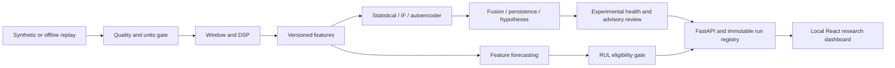

# Discovery and reconciled implementation plan

Date: 2026-10-27. Authority: final autonomous execution instruction supersedes initial WP-01-only and design-only restrictions. No production access authorized.

## Discovery
Read all six supplied specifications and complete pasted request. Current workspace has no source. Read-only inspection found D:/Projects/motor-anomaly-detection: Python >=3.13,<3.14, NumPy/SciPy/PyArrow/Influx client, 93-feature versioned registry, replay/quality/DSP/slip/monitoring modules, sklearn Isolation Forest prototype depending on statorscope, extensive pytest suite, plain HTML dashboards. No React package found in inspected listing. Existing .venv has NumPy/SciPy/pytest but not sklearn, torch, FastAPI. Source and .env are not modified; .env is not read. Git status was denied by sandbox; original working-tree cleanliness is unknown.

Existing D:/Data/motor-anomaly-detection contains raw, processed, models, replay-cache, simulation and experiment directories; contents and measured provenance are not established. Example configuration targets simulated ac_power records. This is not authorization to connect. No credentials loaded. Hardware CIM inventory denied; use process-level platform/CPU/memory reporting during benchmark. Bundled Python 3.12 available; separate workspace virtual environment chosen to avoid altering original Python 3.13 environment.

## Reconciliation and decisions
- Standalone source: outputs/prototype; documentation: outputs/docs; datasets/models/results: outputs/data. These reversible workspace locations avoid unconfirmed D-drive destinations. No changes to existing project.
- WP numbering follows the master request (the delivery attachment uses a different mapping).
- Synthetic first, offline CSV replay second; Influx remains unavailable until read-only contract and authorization established.
- All A/B/C/D tracks implemented. Compact CPU autoencoder; classical forecasts first. Foundation weights deferred; feasibility documented, no large download.
- Window candidates 0.1/0.2/0.5/1/2/5 seconds; versioned windows and no overlap across partitions. Aggregates 10/60/300/900/3600 seconds.
- Synthetic electrical convention explicitly phase-to-neutral with paired currents, 50/60 Hz, 10 kHz. Real power unavailable for unverified convention. Diagnostics are hypotheses; health is experimental; real RUL disabled.
- Documentation's unapproved performance thresholds remain unapproved. Experimental calibration is recorded separately from industrial acceptance criteria.

## Software contracts and file-level plan
`prototype/motorlab/contracts.py`: validated configuration, channel/units and provenance contracts.
`prototype/motorlab/signals.py`: synthetic/replay adapters, quality validation, windowing, filtering, feature/spectrum extraction.
`prototype/motorlab/models.py`: training-only scaler, robust/classical statistics, EWMA/CUSUM, multivariate distance, Isolation Forest, compact autoencoder, calibrated thresholds.
`prototype/motorlab/intelligence.py`: persistence/hysteresis, fusion, evidence hypotheses, health and RUL gates.
`prototype/motorlab/forecast.py`: rolling-origin classical forecasts and intervals.
`prototype/motorlab/experiment.py`: deterministic scenarios, partition manifests, registry, metrics, benchmarks and artifacts.
`prototype/motorlab/api.py`: FastAPI bounded queries, immutable runs, notes and static dashboard.
`prototype/frontend/`: React/TypeScript/Vite dashboard.
`prototype/tests/`: analytical signal, quality, leakage, model, forecast, API and end-to-end tests.

## Architecture

## Dependency and access plan
Dedicated Python venv in work; install numerical/API/testing packages there and capture exact resolved versions. React dependencies are local to prototype. No system-wide packages or services. No production queries/writes, no plant connections, no external alerts. SQLite/JSON/NPZ local artifacts preserve provenance and hashes.

## Evaluation plan and work-package gates
WP-01: document review, source inventory and this reconciliation (complete). WP-02: quality rejection plus analytic RMS/frequency/power/filter tests. WP-03: train-only preprocessing, distinct train/early-stop/calibration/test partitions; compare A/B/C on identical windows and motors. WP-04: severe single-signal preservation, unavailable sensor behavior and explicit unknown-cause/RUL gates. WP-05: rolling-origin naive/trend/robust/smoothing forecasts with horizon errors and interval coverage. WP-06: API contracts, dashboard workflows, persistent notes and export. WP-07: pytest, browser E2E, measured latency/resources, limitations and final suitability assessment. No tests are yet claimed run.

Open external decisions: actual measurement conventions/scaling, rated motor specs, phase wiring, speed/load context, verified healthy/failure labels, live read scope, destination migration and industrial acceptance thresholds. They do not block isolated simulation. Synthetic success cannot establish real-motor suitability.
