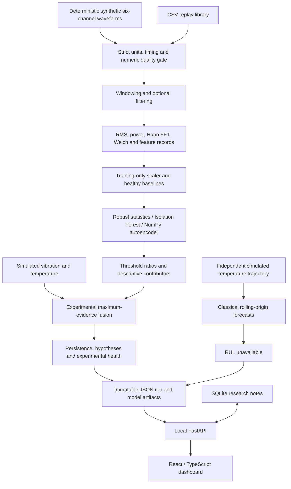

# Implemented architecture

## Modules and contracts
`contracts.py` defines channels, units, sampling metadata, feature schema and window/filter configuration. `signals.py` accepts sample-major arrays, validates raw records, and returns quality, features, spectra, MCSA eligibility and optional-sensor summaries. `models.py` fits only declared healthy partitions and returns raw scores, threshold ratios and alert candidates. `intelligence.py` keeps fusion, persistence, diagnosis and RUL eligibility separate. `forecast.py` forecasts a physical feature, not the anomaly score. `experiment.py` orchestrates simulation and persists lineage. `api.py` exposes local study operations and serves the built dashboard.

Each study resides in a new run directory under `outputs/data`; model pickle files are trusted local artifacts and must not be replaced with untrusted downloads. Notes use a separate SQLite database. Raw full study arrays are regenerated deterministically from manifest settings; the exported report contains features and waveform excerpts rather than redundant full-rate raw copies.

`replay.py` adds an offline CSV-to-feature CLI with overlap and no model mutation. `synthetic_rul.py` adds a separate quadratic residual-bootstrap threshold-crossing experiment with explicit synthetic provenance; its results do not enable real RUL in the application.

The original motor project and its dependencies remain separate. JSON replaces a dedicated feature database in this bounded prototype. A measured Influx adapter, streaming service, GPU backend and production deployment are not implemented.
